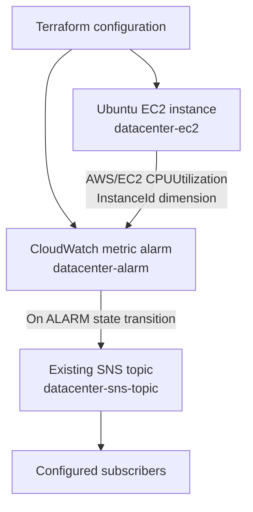

# Day 100 — AWS EC2 CPU Monitoring with Terraform, CloudWatch & SNS

  

> **Final challenge completed — 100/100 Days of DevOps.** Provision an Ubuntu EC2 instance and a CloudWatch CPU alarm with a notification action pointing to an *existing* SNS topic. The lab was validated as passed. The exact successful AMI ID is not preserved here; the supplied `main.tf` uses an official Canonical Ubuntu AMI lookup for portability on standard AWS accounts.

## Challenge objectives

| Setting | Requirement |
|---|---|
| EC2 name tag | `datacenter-ec2` |
| Operating system | Ubuntu AMI (lab offered `ami-0c02fb55956c7d316`, which was not available in the lab during verification) |
| Alarm name | `datacenter-alarm` |
| Namespace / metric | `AWS/EC2` / `CPUUtilization` |
| Statistic | `Average` |
| Threshold / comparison | `90` / `GreaterThanOrEqualToThreshold` |
| Period | `300` seconds (5 minutes) |
| Evaluation periods | `1` |
| Datapoints to alarm | `1` |
| Alarm actions | Existing SNS topic `datacenter-sns-topic` |
| Output names | `KKE_instance_name`, `KKE_alarm_name` |
| Lab working directory | `/home/bob/terraform` |
| Submission condition | `terraform plan` reports **No changes** |

## Architecture



**Key architectural distinction:** the `data.aws_sns_topic.datacenter` data source **looks up** the existing topic; Terraform does not create or manage it. The EC2 instance ID is referenced in alarm dimensions so this alarm monitors one instance, not an aggregate across instances.

## Repository structure

```text
Day-100-Terraform-EC2-CloudWatch-SNS/
├── README.md      # Challenge, architecture, validation, lessons
├── Commands.md    # Commands and checks (copy/paste friendly)
├── Notes.md       # Deep notes and interview preparation
├── main.tf        # EC2, SNS data lookup, CloudWatch alarm
├── outputs.tf     # Exact KodeKloud output names
└── .gitignore     # Exclude state, secrets, generated files
```

`provider.tf` belongs to your target environment and is deliberately **not bundled**: retain the provided AWS provider settings in KodeKloud. The sample `main.tf` uses a Canonical Ubuntu 22.04 LTS AMI data lookup; this works where the AWS provider has permission to describe AMIs and the images are available. If the lab's AWS emulator does not support the lookup, replace the `ami` expression with an **Ubuntu AMI confirmed available in that same environment**.

## Terraform configuration highlights

```hcl
data "aws_sns_topic" "datacenter" {
  name = "datacenter-sns-topic"
}

resource "aws_cloudwatch_metric_alarm" "datacenter_alarm" {
  alarm_name          = "datacenter-alarm"
  namespace           = "AWS/EC2"
  metric_name         = "CPUUtilization"
  statistic           = "Average"
  period              = 300
  evaluation_periods  = 1
  datapoints_to_alarm = 1
  threshold           = 90
  comparison_operator = "GreaterThanOrEqualToThreshold"
  dimensions          = { InstanceId = aws_instance.datacenter_ec2.id }
  alarm_actions       = [data.aws_sns_topic.datacenter.arn]
}
```

- **At or above 90%:** `GreaterThanOrEqualToThreshold` includes exactly 90%; `GreaterThanThreshold` would not.
- **One five-minute evaluation window:** `period = 300`, `evaluation_periods = 1`, `datapoints_to_alarm = 1`.
- **Single-instance monitoring:** `dimensions.InstanceId` targets the provisioned EC2 instance.
- **Notification destination:** CloudWatch alarm action invokes the existing SNS topic when it transitions to `ALARM`, subject to AWS permissions/subscriptions.

## Reproduce (standard AWS account or compatible lab)

1. Configure AWS credentials and verify the existing provider file and region (lab uses `us-east-1`).
2. Confirm the SNS topic already exists. Ensure the configured region and account are correct.
3. Verify an appropriate Ubuntu AMI is available. Do **not** assume the example AMI in the task is valid: it returned `InvalidAMIID.NotFound` in the observed lab run.
4. Review `terraform plan` for **only** the intended changes, then run `terraform apply`.
5. Inspect the output names and the CloudWatch alarm's `InstanceId`, statistic, threshold, period, and SNS action.
6. Run `terraform plan` again and submit only when the output is **No changes. Your infrastructure matches the configuration.**

See [Commands.md](Commands.md) for exact commands and [Notes.md](Notes.md) for concepts and troubleshooting.

## Validation evidence and completion

The Day 100 KodeKloud challenge was **reported passed by the learner**. Prior to completion, the initially suggested example Ubuntu AMI `ami-0c02fb55956c7d316` returned `InvalidAMIID.NotFound` on the provided lab backend; the solution required an available Ubuntu AMI instead. The final deployed AMI ID is **not known from the provided screenshots** and is intentionally not fabricated here.

Typical end-of-run checks:

```bash
terraform output
terraform state list
terraform plan
```

Expected outputs:

```text
KKE_alarm_name = "datacenter-alarm"
KKE_instance_name = "datacenter-ec2"
```

Expected plan:

```text
No changes. Your infrastructure matches the configuration.
```

## Production considerations

- Security group, subnet and IAM design should be explicit for production; the lab focused only on EC2 and alerting.
- An existing SNS topic needs appropriate policy/subscriptions; creating the alarm action does not itself guarantee message delivery.
- EC2 basic monitoring may publish CPU data at five-minute intervals; detailed monitoring publishes at one-minute intervals. A five-minute alarm period can work with either.
- `treat_missing_data = "missing"` avoids treating absent CPU samples as a real high-CPU breach; investigate missing metrics separately.
- Protect Terraform state, use remote backends with encryption and locking where appropriate, and review drift rather than masking it with `ignore_changes`.
- Do not commit AWS credentials, state files, private keys, or sensitive `.tfvars` files.

## Skills demonstrated

**Terraform IaC · AWS EC2 · Amazon CloudWatch · Amazon SNS · Observability · Alarm Thresholds · Terraform Data Sources · Dependencies · State and Drift Detection · AWS CLI Troubleshooting**

---

**Milestone:** Completed **100 of 100 KodeKloud DevOps challenges**. The final task connected infrastructure-as-code provisioning with actionable operational monitoring and notifications.
